# Zero Knowledge Proof family tree

Runnable, self-contained Python demos of the major "privacy / trust-minimization"
cryptographic protocol families: zero-knowledge proofs, secret sharing,
multi-party computation, threshold cryptography, homomorphic encryption,
multisig / aggregate signatures, and commitment schemes.

## ⚠️ Read this first

**Nothing in this repo is production-grade.** Parameters are small (fast, not secure),
there is no side-channel protection, no input validation, and no security audit.
These scripts exist to make the *math* and *protocol flow* legible, not to be a
crypto library. Use `cryptography`, `pynacl`, or a vetted MPC/ZK framework
(circom, arkworks, MP-SPDZ, py_frost, etc.) for anything real.

## Taxonomy

```
Cryptographic protocols for privacy & trust minimization
│
├── 01 Zero-knowledge proofs ................ prove without revealing
│   ├── Interactive:      Schnorr sigma protocol
│   ├── Non-interactive:  Fiat-Shamir NIZK
│   └── Commitment:       Pedersen commitment
│
├── 02 Secret sharing ........................ split a secret into shares
│   ├── Shamir secret sharing (t-of-n, polynomial-based)
│   └── Feldman VSS (Shamir + publicly verifiable shares)
│
├── 03 Multi-party computation ............... compute jointly, inputs stay private
│   ├── Additive secret-sharing MPC (secure sum)
│   ├── Oblivious transfer (1-out-of-2, RSA-based)
│   └── Garbled circuits (Yao's protocol, single AND gate)
│
├── 04 Threshold cryptography ................ t-of-n key operations
│   ├── Distributed key generation (Pedersen DKG)
│   └── Threshold Schnorr signing (FROST-style)
│
├── 05 Homomorphic encryption ................ compute on ciphertext
│   ├── Paillier (additively homomorphic)
│   └── ElGamal (multiplicatively homomorphic)
│
├── 06 Multisig & aggregate signatures ....... joint signing schemes
│   ├── Naive n-of-n multisig (independent signatures)
│   ├── MuSig (Schnorr key & signature aggregation)
│   └── BLS aggregate signatures (pairing-based)
│
└── 07 Commitment schemes & OT ............... shared building-block primitives
    ├── Hash-based commitment (commit-reveal)
    └── Merkle tree commitment (set membership)
```


```mermaid
flowchart TD
    ROOT["Cryptographic protocols for<br/>privacy & trust minimization"]
    ROOT --> ZKP["01 Zero-knowledge proofs"]
    ROOT --> SS["02 Secret sharing"]
    ROOT --> MPC["03 Multi-party computation"]
    ROOT --> TC["04 Threshold cryptography"]
    ROOT --> HE["05 Homomorphic encryption"]
    ROOT --> MS["06 Multisig / aggregate sigs"]
    ROOT --> CM["07 Commitment schemes & OT"]

    ZKP --> ZKP1[Schnorr sigma protocol]
    ZKP --> ZKP2[Fiat-Shamir NIZK]
    ZKP --> ZKP3[Pedersen commitment]

    SS --> SS1[Shamir secret sharing]
    SS --> SS2[Feldman VSS]

    MPC --> MPC1[Additive secure sum]
    MPC --> MPC2[Oblivious transfer]
    MPC --> MPC3[Garbled circuits]

    TC --> TC1[Pedersen DKG]
    TC --> TC2[Threshold Schnorr]

    HE --> HE1[Paillier]
    HE --> HE2[ElGamal]

    MS --> MS1[Naive n-of-n multisig]
    MS --> MS2[MuSig aggregation]
    MS --> MS3[BLS aggregate signatures]

    CM --> CM1[Hash commitment]
    CM --> CM2[Merkle tree]
```

*(the fenced block above renders as an actual diagram on GitHub, Obsidian,
and any Markdown viewer with Mermaid support; the ASCII tree above it is the
guaranteed-to-render fallback everywhere else, including a plain text editor.)*

## A running example, used across every README in this repo

To make the math checkable by hand instead of taken on faith, most folders
reuse **the same toy numbers**:

> Prime `p = 23`, generator `g = 5` (5 is a primitive root mod 23, so it
> generates every nonzero element as you raise it to powers 1..22).
> Secret `x = 6`  →  public key `y = g^x mod p = 5^6 mod 23 = 8`.
> (Check: 5²=25=2, 5³=10, 5⁴=50=4, 5⁵=20, 5⁶=100=100-92=**8**. ✓)

These numbers are laughably small — real code in this repo uses a real
1536-bit safe prime — but small enough that you can verify every modular
exponentiation on a calculator and *see* why each protocol works, instead of
just trusting that it does.

## Layout

| Folder | Family | Depends on |
|---|---|---|
| `01_zero_knowledge_proofs/` | Schnorr sigma protocol, Fiat-Shamir NIZK, Pedersen commitment | stdlib only |
| `02_secret_sharing/` | Shamir secret sharing, Feldman VSS | stdlib only |
| `03_multi_party_computation/` | Additive-share secure sum, 1-out-of-2 oblivious transfer, toy garbled AND gate | stdlib only |
| `04_threshold_cryptography/` | Pedersen DKG, threshold Schnorr signing | stdlib only |
| `05_homomorphic_encryption/` | Paillier (additive), ElGamal (multiplicative) | stdlib only |
| `06_multisig_aggregate_signatures/` | naive n-of-n, MuSig-style Schnorr aggregation, BLS aggregate signature | `py_ecc` for BLS only |
| `07_commitment_schemes_and_ot/` | hash commitments, Merkle tree commitments | stdlib only |

Each folder is standalone — unzip and `python3 <file>.py`, no imports across
folders. Each folder's `README.md` gives you, per algorithm: the plain-English
idea, a **numbered step-by-step protocol walkthrough**, the underlying math
(*why* each step exists, not just what it is), a **hand-checkable worked
numeric example**, and when to use it / not use it.

## How the families compose

- Threshold signatures = secret sharing + MPC over a signing circuit.
- zk-SNARKs are built on the same commitment schemes in `07_`.
- MPC protocols (`03_`) are built from oblivious transfer + secret sharing.
- Multisig (`06_`) is threshold crypto (`04_`) wearing an application hat.

## Which family do I need? A decision guide

Answer these in order — stop at the first "yes":

1. **Do you need to prove you know a secret, or that a statement is true,
   without revealing the secret itself?**
   → `01_zero_knowledge_proofs/` (Schnorr / Fiat-Shamir / Pedersen)

2. **Do you need to split a secret across several people so that a minimum
   number of them can reconstruct it later, but fewer cannot?** (No ongoing
   computation — just safekeeping and eventual recovery.)
   → `02_secret_sharing/` (Shamir / Feldman VSS)

3. **Do multiple parties need to jointly COMPUTE something (a sum, a
   comparison, a match) over private inputs, where nobody should learn
   anyone else's raw input — not even the person running the computation?**
   → `03_multi_party_computation/` (additive MPC / OT / garbled circuits)

4. **Do you need a single key that gets used REPEATEDLY (to sign or
   decrypt), where no individual party should ever hold the full key at
   any point, including during setup?**
   → `04_threshold_cryptography/` (DKG / threshold Schnorr)

5. **Do you need a third party (e.g. a cloud server) to perform arithmetic
   ON YOUR ENCRYPTED DATA and hand back an encrypted result, without ever
   decrypting your inputs?**
   → `05_homomorphic_encryption/` (Paillier / ElGamal)

6. **Do you need several specific, named people to approve/sign the SAME
   message or transaction (not compute something new, just co-sign)?**
   → `06_multisig_aggregate_signatures/` (naive multisig / MuSig / BLS)

7. **Do you need to lock in a value (or a whole dataset) now, and prove
   later what it was — or prove one item belongs to a larger committed
   set — without a live protocol running the whole time?**
   → `07_commitment_schemes_and_ot/` (hash commitment / Merkle tree)

**If more than one applies:** these compose. A typical wallet custody
system, for example, layers #4 (threshold key never fully assembled) with
#6 (the resulting signature looks like a multisig or is a single Schnorr
signature) and #1 (proving the setup ceremony was done correctly). Read the
"How the families compose" section above once you know which pieces you need.
